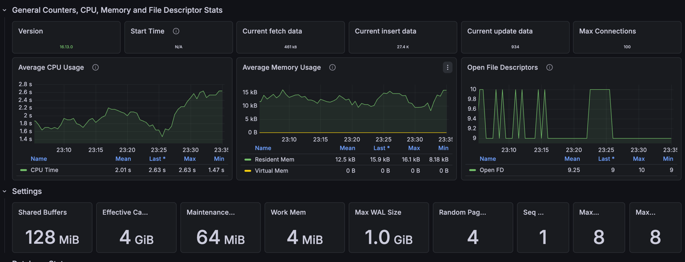
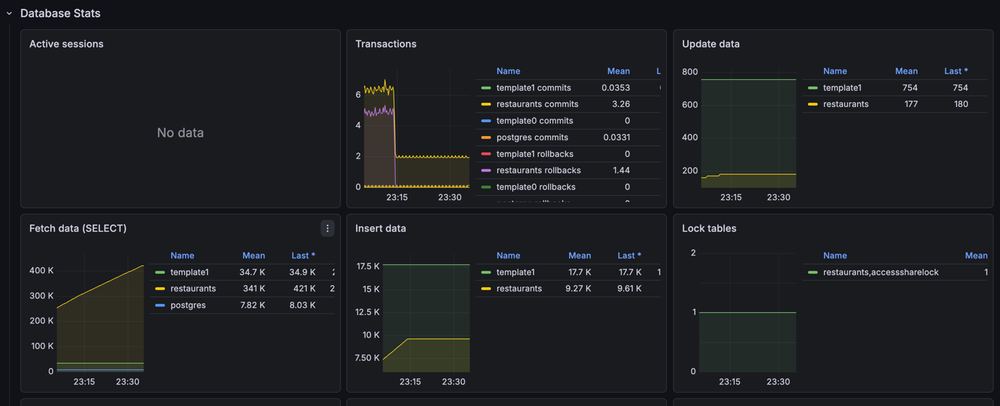
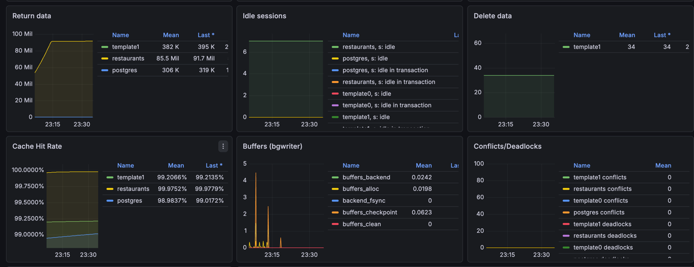
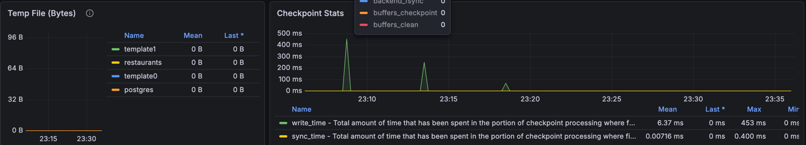
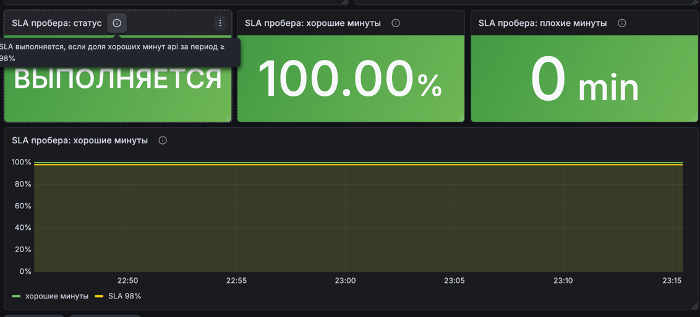
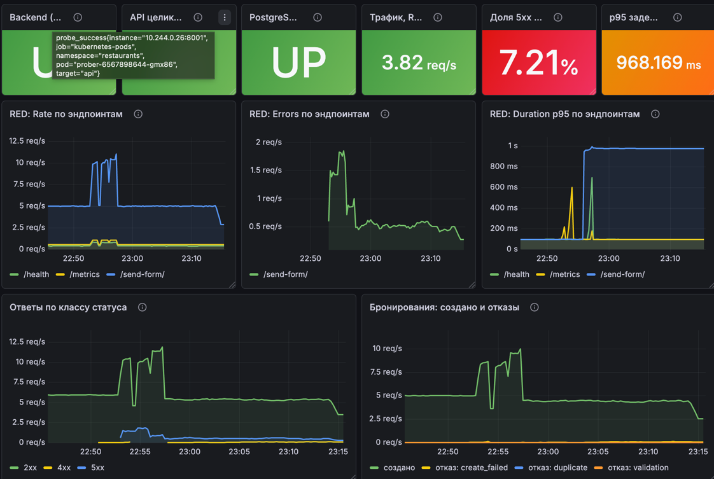
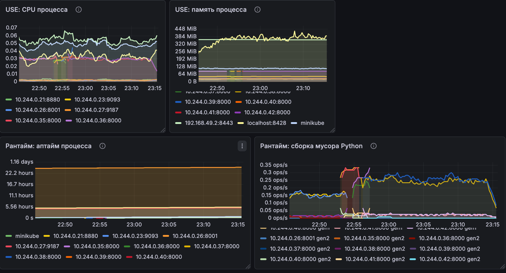

# Отчет Grafana

## Дашборд 1: PostgreSQL Database

Источник данных: VictoriaMetrics (Prometheus)

### Панели

1. Active sessions — Количество активных сессий PostgreSQL по базе данных и состоянию.\
Метрика выбрана для контроля текущей активности пользователей и нагрузки на базу данных, а также выявления большого количества одновременно выполняемых запросов.

2. Idle sessions — Количество неактивных сессий в различных состояниях ожидания.\
Позволяет отслеживать простаивающие подключения, выявлять избыточное использование соединений и потенциальные утечки подключений.

3. Lock tables — Количество блокировок таблиц по типу режима блокировки.\
Необходима для выявления конкуренции за ресурсы базы данных и ситуаций, когда запросы ожидают освобождения таблиц.

4. Fetch data (SELECT) — Количество строк, полученных операциями SELECT.\
Позволяет оценивать интенсивность операций чтения и активность запросов на получение данных.

5. Insert data — Количество строк, вставленных операциями INSERT.\
Используется для оценки интенсивности добавления новых данных и нагрузки на базу при операциях записи.

6. Update data — Количество строк, обновленных операциями UPDATE.\
Позволяет отслеживать активность изменения существующих записей и нагрузку, связанную с обновлением данных.

7. Delete data — Количество строк, удаленных операциями DELETE.\
Необходима для контроля операций удаления и выявления необычных изменений объема данных.

8. Return data — Количество строк, возвращенных из таблиц.\
Позволяет оценивать общий объем данных, обрабатываемых запросами, и анализировать интенсивность работы с таблицами.

9. Transactions — Скорость коммитов и откатов транзакций по базе данных.\
Используется для оценки интенсивности транзакционной активности и соотношения успешно завершенных и отмененных транзакций.

10. Cache Hit Rate — Коэффициент попадания в кэш блоков данных.\
Позволяет оценить эффективность использования кэша PostgreSQL и определить, насколько часто системе приходится обращаться к диску.

11. Buffers (bgwriter) — Скорость работы фоновых процессов записи буферов.\
Помогает контролировать работу фоновой записи и оценивать нагрузку на подсистему ввода-вывода.

12. Conflicts/Deadlocks — Количество конфликтов и взаимных блокировок.\
Необходима для выявления проблем конкурентного доступа к данным, которые могут приводить к задержкам и отмене транзакций.

13. Temp File (Bytes) — Объем данных, записанных во временные файлы.\
Позволяет выявлять запросы, которым не хватает выделенной оперативной памяти и которые используют диск для промежуточных вычислений.

14. Checkpoint Stats — Время выполнения операций записи и синхронизации контрольных точек.\
Используется для контроля эффективности контрольных точек и выявления чрезмерной нагрузки на дисковую подсистему.

15. Average CPU Usage — Среднее использование процессорного времени процессом PostgreSQL.\
Позволяет оценивать процессорную нагрузку базы данных и выявлять ситуации, когда вычислительных ресурсов становится недостаточно.

16. Average Memory Usage — Среднее использование резидентной и виртуальной памяти.\
Необходима для контроля потребления оперативной памяти и выявления возможного чрезмерного использования ресурсов.

17. Open File Descriptors — Количество открытых файловых дескрипторов.\
Позволяет контролировать использование системных ресурсов и своевременно обнаруживать возможные утечки дескрипторов.

18. Start Time — Время запуска процесса PostgreSQL.\
Позволяет определить момент последнего запуска или перезапуска базы данных и контролировать стабильность ее работы.

19. Version — Версия PostgreSQL.\
Используется для контроля установленной версии СУБД, планирования обновлений и проверки совместимости компонентов.

20. Max Connections — Максимальное количество подключений.\
Позволяет контролировать установленный лимит соединений и оценивать доступный запас подключений для приложения.

21. Shared Buffers — Размер разделяемых буферов.\
Необходима для контроля объема памяти, выделенной PostgreSQL для кэширования страниц данных.

22. Effective Cache — Размер эффективного кэша.\
Позволяет оценить объем памяти, который планировщик запросов учитывает при выборе стратегии выполнения операций.

23. Maintenance Work Mem — Объем памяти для операций обслуживания.\
Используется для контроля ресурсов, выделенных на VACUUM, CREATE INDEX и другие операции обслуживания базы данных.

24. Work Mem — Объем рабочей памяти.\
Позволяет контролировать объем памяти, выделяемой для сортировок и операций соединения таблиц, и оценивать риск использования временных файлов.

25. Max WAL Size — Максимальный размер WAL.\
Необходима для контроля настроек журнала предзаписи и управления объемом данных, используемых при восстановлении базы.

26. Random Page Cost — Стоимость случайного чтения страницы.\
Позволяет контролировать параметр планировщика запросов, влияющий на выбор между последовательным и индексным чтением.

27. Seq Page Cost — Стоимость последовательного чтения страницы.\
Используется для контроля настроек планировщика и оценки предпочтительности последовательного сканирования таблиц.

28. Max Worker Processes — Максимальное количество рабочих процессов.\
Позволяет контролировать лимит фоновых рабочих процессов, доступных PostgreSQL для выполнения различных задач.

29. Max Parallel Workers — Максимальное количество параллельных рабочих процессов.\
Необходима для контроля возможностей параллельного выполнения запросов и оценки доступных ресурсов для ускорения обработки данных.

30. Current fetch data — Текущее количество полученных строк.\
Позволяет отслеживать накопительное количество строк, полученных операциями чтения, и оценивать общую активность SELECT-запросов.

31. Current insert data — Текущее количество вставленных строк.\
Используется для контроля накопительного количества новых записей и оценки общего объема операций добавления данных.

32. Current update data — Текущее количество обновленных строк.\
Позволяет отслеживать накопительное количество изменений записей и оценивать интенсивность операций обновления.

Метрики PostgreSQL

## Дашборд 2: Состояние приложения и SLA пробера

Источник данных: VictoriaMetrics (Prometheus)

### Панели

1. Backend (проба /health) — Статус доступности backend по эндпоинту `/health`.\
Метрика выбрана для проверки работоспособности backend на уровне приложения и своевременного обнаружения его недоступности.

2. API целиком (nginx → backend → БД) — Статус доступности всего API стека.\
Позволяет проверять работоспособность всей цепочки взаимодействия компонентов и выявлять проблемы, которые невозможно обнаружить проверкой одного backend.

3. PostgreSQL (pg_up) — Статус доступности PostgreSQL от postgres-exporter.\
Необходима для контроля доступности базы данных и быстрого определения проблем на уровне СУБД.

4. Трафик, RPS (Traffic) — Общее количество HTTP-запросов в секунду.\
Позволяет оценивать интенсивность входящего трафика, отслеживать изменения нагрузки и выявлять резкие скачки количества запросов.

5. Доля 5xx (Errors) — Процент ответов с кодами 5xx от всех запросов.\
Используется для оценки частоты серверных ошибок и определения ухудшения качества работы приложения.

6. p95 задержки (Latency) — 95-й перцентиль времени ответа всех эндпоинтов.\
Позволяет оценивать время отклика приложения с учетом медленных запросов, которые могут оставаться незаметными при анализе среднего времени ответа.

7. RED: Rate по эндпоинтам — Количество запросов в секунду по каждому handler.\
Необходима для определения наиболее востребованных API-методов и распределения нагрузки между эндпоинтами.

8. RED: Errors по эндпоинтам — Количество ответов 5xx в секунду по каждому эндпоинту.\
Позволяет локализовать источники серверных ошибок и определить, какие именно API-методы работают нестабильно.

9. RED: Duration p95 по эндпоинтам — 95-й перцентиль времени ответа по каждому эндпоинту.\
Используется для выявления наиболее медленных API-методов и определения участков приложения, требующих оптимизации.

10. Ответы по классу статуса — Распределение HTTP-ответов по классам статусов.\
Позволяет оценивать соотношение успешных ответов, ошибок клиента и серверных ошибок, получая общую картину качества работы API.

11. Бронирования: создано и отказы — Бизнес-метрики создания бронирований и причин отказов.\
Необходима для контроля выполнения основных бизнес-операций и выявления проблем, влияющих непосредственно на пользовательский сценарий бронирования.

12. USE: CPU процесса — Доля процессорного времени, занятая процессом.\
Позволяет оценивать использование процессорных ресурсов приложением и выявлять возможную нехватку вычислительной мощности.

13. USE: память процесса — Размер памяти процесса по инстансам.\
Используется для контроля потребления оперативной памяти и обнаружения чрезмерного роста потребления ресурсов.

14. Рантайм: аптайм процесса — Время работы процесса с момента запуска.\
Позволяет отслеживать стабильность работы приложения, выявлять частые перезапуски и контролировать непрерывность его функционирования.

15. Рантайм: сборка мусора Python — Скорость сборки мусора Python по поколениям.\
Необходима для анализа активности механизма управления памятью Python и выявления повышенной нагрузки, связанной с удалением объектов.

16. SLA пробера: статус — Статус выполнения SLA (выполняется/нарушен).\
Позволяет оперативно определить, соответствует ли доступность API установленным требованиям SLA, и своевременно обнаруживать нарушения.

17. SLA пробера: хорошие минуты — Доля минут без неуспешных проб API.\
Используется для оценки фактической доступности сервиса за выбранный период и определения доли времени его бесперебойной работы.

18. SLA пробера: плохие минуты — Количество минут с неуспешными пробами API.\
Позволяет оценивать продолжительность проблем с доступностью сервиса и отслеживать частоту возникновения сбоев.

19. SLA пробера: хорошие минуты (график) — Доля хороших минут с порогом 98%.\
Позволяет наглядно отслеживать динамику доступности API, сравнивать ее с установленным порогом SLA и своевременно замечать приближение к нарушению требований.

Подсчет SLA пробера

Метрики приложения

Итог: первый дашборд предназначен для мониторинга внутреннего состояния PostgreSQL, контроля нагрузки, использования ресурсов и эффективности работы СУБД. Второй дашборд позволяет оценивать доступность приложения, производительность API, потребление ресурсов, корректность бизнес-операций и соблюдение установленного SLA.
