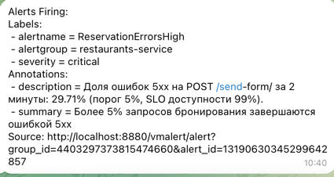
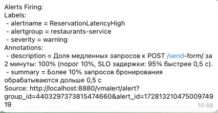
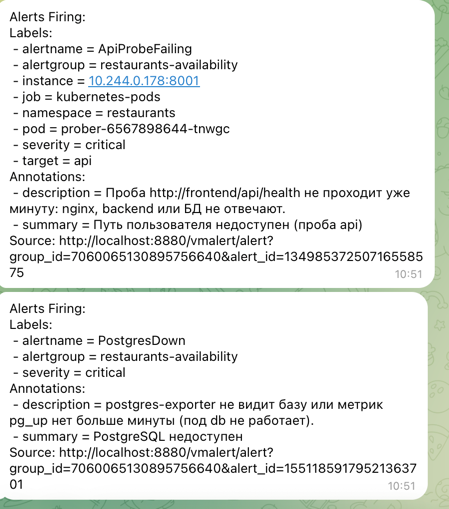

# Отчёт алерты

## 1. Как устроен мониторинг алертов

- **vmalert** читает метрики из VictoriaMetrics, каждые 15 секунд вычисляет правила и записывает состояние алертов обратно в виде метрики `ALERTS`.
- **Alertmanager** получает сработавшие алерты, объединяет их в сообщения, подавляет лишние и отправляет уведомления в Telegram.
- Правила лежат в `k8s/vmalert-rules.yml`, конфигурация Alertmanager в `k8s/alertmanager-secret-.yml`.

## 2. Какие алерты выбраны и почему

Принцип: алертить нужно на то, что чувствует пользователь. Пороги привязаны к SLO. Каждый алерт имеет время ожидания `for`.

### Метрики сервиса

| Алерт | Условие | for | Важность | Почему |
|---|---|---|---|---|
| **ReservationErrorsHigh** | доля ответов 5xx на `POST /send-form/` за 2 мин > 5% | 1 мин | critical | это нарушение SLO доступности (99%): гости не могут забронировать стол. Порог 5% вместо 1% отсекает случайные ошибки |
| **ReservationLatencyHigh** | доля запросов медленнее 0,5 с за 2 мин > 10% | 2 мин | warning | нарушение SLO задержки (95% быстрее 0,5 с). Сервис работает, но тормозит, срочности нет, поэтому warning |
| **BookingFailuresHigh** | доля отказов «нет свободных столов» за 5 мин > 50% | 3 мин | warning | бизнес-сигнал: рестораны заполнены или идёт аномальный трафик, теряем гостей |

### Доступность

| Алерт | Условие | for | Важность | Почему |
|---|---|---|---|---|
| **ApiProbeFailing** | `probe_success{target="api"} == 0` | 1 мин | critical | пробер проверяет весь путь пользователя (nginx, backend, БД). Ловит недоступность, даже когда запросов нет |
| **PostgresDown** | `min(pg_up) == 0` или метрики `pg_up` нет | 1 мин | critical | без БД бронирование не работает. Условие «метрики нет» нужно потому, что при остановке пода БД `pg_up` не становится 0, а исчезает |

### Метрики рантайма Python

| Алерт | Условие | for | Важность | Почему |
|---|---|---|---|---|
| **BackendCPUHigh** | `rate(process_cpu_seconds_total[2m]) > 0.8` ядра | 3 мин | warning | Python-процесс использует одно ядро, около 0,8 и выше значит, что backend упирается в процессор и скоро начнёт тормозить |
| **BackendMemoryHigh** | `process_resident_memory_bytes > 300 МиБ` | 5 мин | warning | типичный размер процесса около 100 МиБ, устойчивый рост выше 300 МиБ говорит об утечке памяти |

Алерты по рантайму ловят проблему **до** того, как её увидят пользователи, а алерты по сервису и доступности сообщают, что проблема уже есть.

## 3. Настройка Alertmanager

| Настройка | Значение | Зачем |
|---|---|---|
| `group_by` | `alertname` | одинаковые алерты с разных подов приходят одним сообщением |
| `group_wait` | 10 с | ждём, не сработают ли ещё связанные алерты, чтобы не слать по одному |
| `group_interval` | 30 с | как часто добавлять новые алерты в уже отправленную группу |
| `repeat_interval` | 1 ч (critical: 30 мин) | напоминание, пока проблема не закрыта; для критичных чаще |
| `send_resolved` | `true` | приходит сообщение, когда алерт погас |
| правило подавления | `PostgresDown` подавляет `ReservationErrorsHigh` и `ApiProbeFailing` | если упала БД, причина уже названа, остальные алерты были бы шумом |

Канал уведомлений: Telegram-бот.

## 4. Как показано срабатывание

Нагрузка создаётся командой `python3 scripts/load.py --url <адрес фронтенда> --rps 5`.

### Сценарий 1. Ошибки сервера → `ReservationErrorsHigh`

```sh
kubectl set env deployment/backend-deployment -n restaurants CHAOS_ERROR_RATE=0.3
```

30% запросов к форме завершаются ошибкой 500. В Telegram приходит сообщение.

Восстановление - `CHAOS_ERROR_RATE=0`.

### Сценарий 2. Медленные ответы → `ReservationLatencyHigh`

```sh
kubectl set env deployment/backend-deployment -n restaurants CHAOS_DELAY_MS=800
```

Все запросы медленнее 0,5 с, алерт срабатывает.

Возврат: `CHAOS_DELAY_MS=0`.

### Сценарий 3. Недоступна БД → `PostgresDown`, `ApiProbeFailing`

```sh
kubectl scale statefulset db -n restaurants --replicas=0
```

Сработают `PostgresDown` и `ApiProbeFailing`. Благодаря правилу подавления `ApiProbeFailing` и `ReservationErrorsHigh` в уведомления не попадают, приходит одно сообщение с причиной.

Возврат: `--replicas=1`.

## 5. Запуск

```sh
kubectl apply -f k8s/ -n restaurants
```
