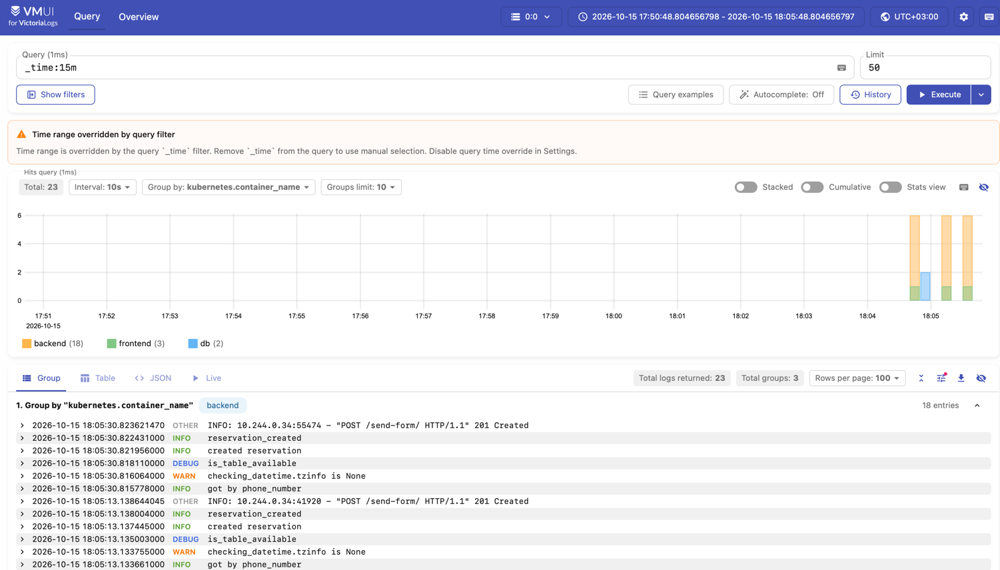
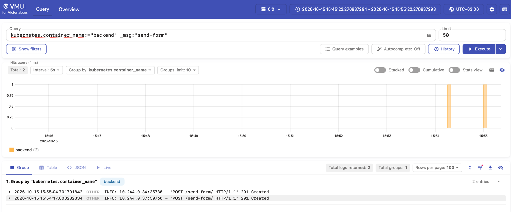
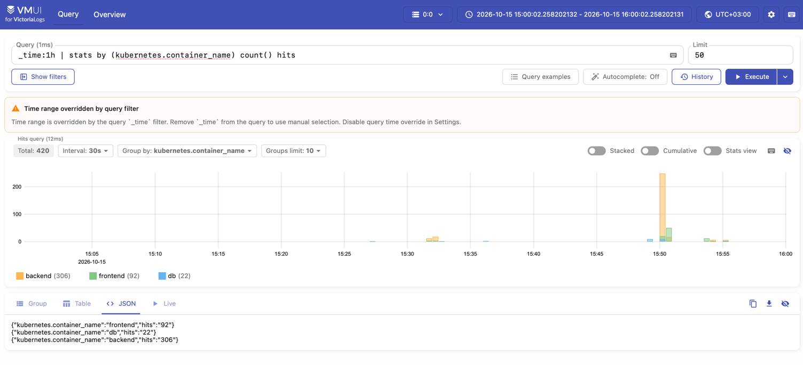
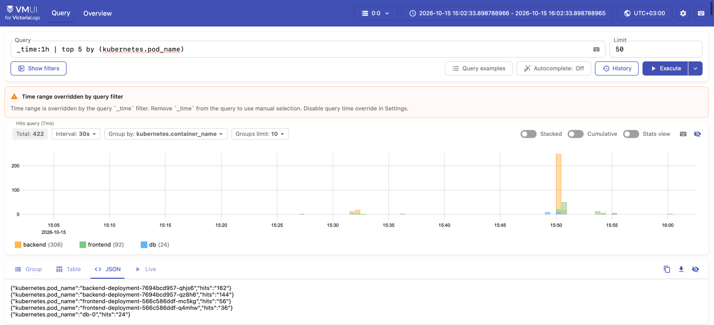

## Способ доставки логов
Для доставки выбран Vector, запущенный в Kubernetes как DaemonSet. Он читает файлы логов контейнеров
с каждой ноды (/var/log/pods) через источник kubernetes_logs, добавляет метаданные Kubernetes (namespace,
имя пода и контейнера) и отправляет записи в VictoriaLogs через ES-bulk эндпоинт /insert/elasticsearch/,
который VictoriaLogs поддерживает из коробки.\
*Причины выбора:*\
Приложение не нужно менять: контейнеры пишут в stdout, а сбор вынесен в инфраструктуру.
DaemonSet запускает один агент на ноду, поэтому логи новых подов подхватываются автоматически.
Тот же Vector использовался в docker compose, при переходе в Kubernetes заменён только источник (docker_logs
на kubernetes_logs).
Сайдкары увеличивают число контейнеров в каждом поде, OpenTelemetry Collector оправдан в основном при сборе
трейсов и метрик вместе с логами, а прямая отправка из приложения привязывает код к конкретному хранилищу.

## Запросы
### (а) Сырые записи за последние N минут
*Запрос:* `_time:15m`\
*Что делает:* выводит необработанные записи логов всех сервисов за выбранный период и показывает, что именно
пишут приложения.\
*Результат:*

*Вывод:* в VictoriaLogs поступают логи всех трёх компонентов: backend (18 записей), frontend (3) и db (2),
всего 23. У записей бэкенда определяются уровни INFO, DEBUG и WARN. Строки access-лога uvicorn, nginx и
Postgres пишутся текстом и имеют уровень OTHER.

### (б) Фильтр по конкретному полю
*Запрос:* `kubernetes.container_name:="backend" _msg:"send-form"`\
*Что делает:* оставляет только записи контейнера backend, в тексте которых есть send-form, то есть события
отправки формы бронирования.

*Вывод:* по фильтру найдено 2 записи, обе POST /send-form/ ... 201 Created, и все из контейнера backend.
Это показывает, что из общего потока можно выделить нужные события по значению поля.

### (в) Агрегация с группировкой
*Запрос:* `_time:1h | stats by (kubernetes.container_name) count() hits`\
*Что делает:* считает количество записей за последний час отдельно по каждому контейнеру.

*Вывод:* за час пришло 420 записей: backend 306, frontend 92, db 22. Логи приходят от всех сервисов, больше
всего пишет бэкенд.

### (г) Агрегирующий запрос (top)
*Запрос:* `_time:1h | top 5 by (kubernetes.pod_name)`\
*Что делает:* выводит пять подов, от которых за час пришло больше всего записей.

*Вывод:* две реплики бэкенда дают больше всего записей (162 и 144), затем две реплики фронтенда (56 и 36)
и db-0 (24). Нагрузка между репликами распределена близко к равномерной, а самые шумные источники логов
— поды бэкенда.