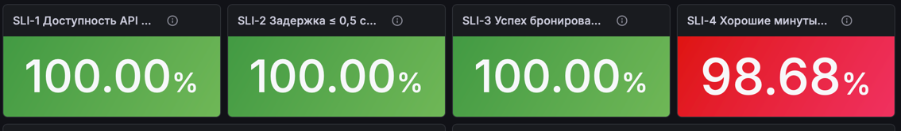
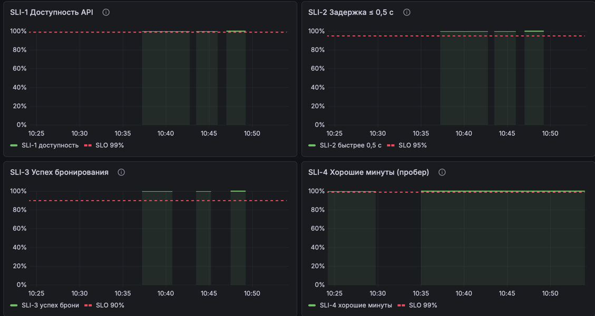
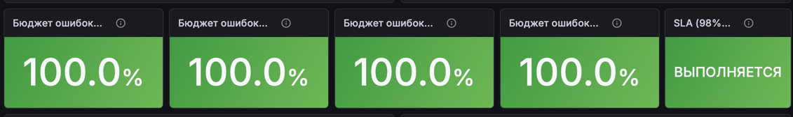
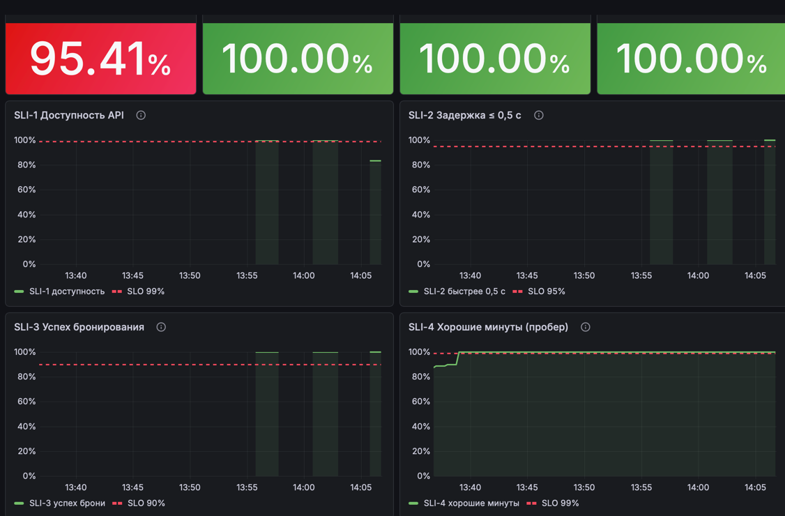
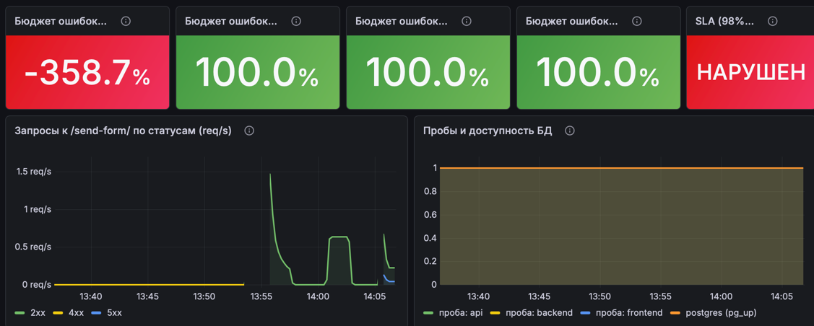
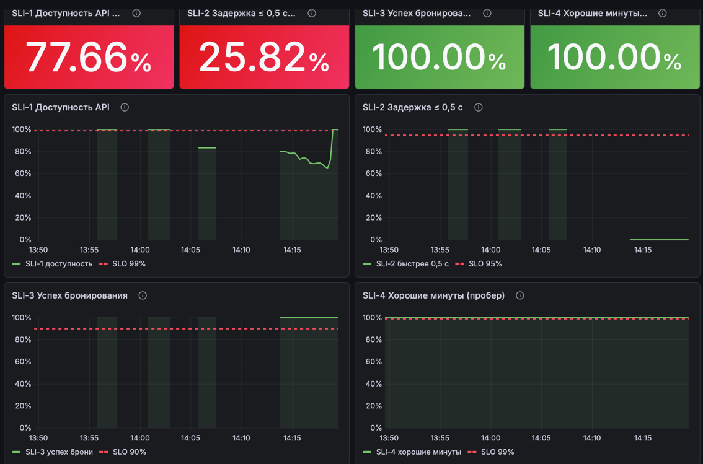
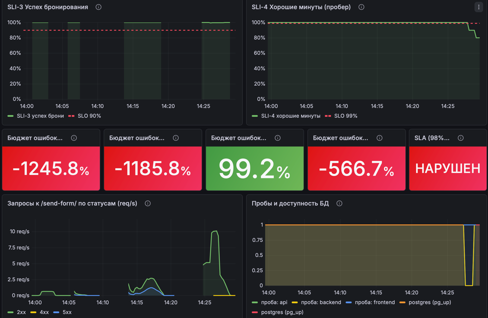

# Отчёт: SLI, SLO и SLA для сервиса бронирования столов

Для расчёта использованы метрики из прошлой домашки (VictoriaMetrics, `prometheus-fastapi-instrumentator`,
бизнес-метрики) и пробер (backend/prober.py). Графики построены в Grafana, источник данных — VictoriaMetrics.

## 1. Выбранные метрики

| Метрика | Тип | Откуда | Что показывает |
|---|---|---|---|
| `http_requests_total{handler, method, status}` | Counter | instrumentator | число HTTP-запросов по эндпоинтам и классам статусов (`2xx`, `4xx`, `5xx`) |
| `http_request_duration_seconds_bucket{handler, le}` | Histogram | instrumentator | сколько запросов уложилось в 0,1 / 0,5 / 1 с |
| `reservations_created_total{restaurant}` | Counter | бизнес-метрика | успешно созданные брони |
| `reservations_rejected_total{reason}` | Counter | бизнес-метрика | отклонённые заявки: `validation`, `duplicate`, `create_failed` (нет свободных столов) |
| `probe_runs_total{target, result}` | Counter | пробер | число проб по результатам `success` / `fail` |
| `probe_success{target}` | Gauge | пробер | результат последней пробы (1 — успешно) |
| `pg_up` | Gauge | postgres-exporter | БД доступна для exporter (для контекста на дашборде) |

**Пробер** — отдельный под `prober` в namespace `restaurants`. Каждые 5 секунд он обращается к трём адресам:

| `target` | Адрес | Что проверяет |
|---|---|---|
| `frontend` | `http://frontend/` | nginx отдаёт страницу |
| `backend` | `http://backend:8000/health` | приложение и БД (напрямую) |
| `api` | `http://frontend/api/health` | весь путь пользователя: nginx → backend → БД |

Проба успешна, если ответ получен за 2 секунды с кодом 2xx. Эндпоинт `/health` выполняет `SELECT 1`
в PostgreSQL и возвращает 503, если БД недоступна.

## 2. SLI, SLO, SLA

Окно оценки SLO: **30 дней**. На скринкасте окно сокращено до выбранного на дашборде периода (последние
15–30 минут), формулы при этом те же.

Ответы 4xx (`400` вне рабочего времени, `409` дубликат) считаются **корректной работой сервиса**: это
ошибки пользователя. Ошибками считаются только ответы 5xx.

### SLI-1. Доступность API (RBSLO)

Доля запросов бронирования, обработанных без ошибки сервера:

```
SLI-1 = запросы POST /send-form/ без 5xx / все запросы POST /send-form/
```
```
sum(rate(http_requests_total{handler="/send-form/",status!~"5.."}[2m]))
/
sum(rate(http_requests_total{handler="/send-form/"}[2m]))
```

**SLO-1:** SLI-1 ≥ **99%** за 30 дней. Бюджет ошибок: 1% запросов.

### SLI-2. Задержка (RBSLO)

Доля запросов бронирования, обработанных за 0,5 секунды или быстрее:

```
SLI-2 = запросы /send-form/ быстрее 0,5 с / все запросы /send-form/
```
```
sum(rate(http_request_duration_seconds_bucket{handler="/send-form/",le="0.5"}[2m]))
/
sum(rate(http_request_duration_seconds_count{handler="/send-form/"}[2m]))
```

**SLO-2:** SLI-2 ≥ **95%** за 30 дней. Бюджет ошибок: 5% запросов.

### SLI-3. Успех бронирования (бизнес-метрика, RBSLO)

Доля заявок, дошедших до поиска стола, в которых стол нашёлся и бронь создана:

```
SLI-3 = созданные брони / (созданные брони + отказы create_failed)
```
```
sum(rate(reservations_created_total[2m]))
/
(sum(rate(reservations_created_total[2m])) + sum(rate(reservations_rejected_total{reason="create_failed"}[2m])))
```

**SLO-3:** SLI-3 ≥ **90%** за 30 дней. Бюджет ошибок: 10% заявок. Показатель падает, когда в ресторане
заканчиваются свободные столы.

### SLI-4. Доступность по пробам (TBSLO)

Здесь считаются не запросы, а время. Минута **хорошая**, если за неё не было ни одной неуспешной пробы
цели `api`. Остальные минуты — плохие.

```
SLI-4 = хорошие минуты / все минуты периода
```
```
avg_over_time((increase(probe_runs_total{target="api",result="fail"}[1m]) == bool 0)[30d:1m])
```

**SLO-4:** SLI-4 ≥ **99%** хороших минут за 30 дней. Бюджет ошибок: 1% времени, то есть **7 ч 12 мин**
плохих минут за 30 дней (43 200 мин × 1%).

### Бюджет ошибок

```
остаток бюджета = 1 − (1 − SLI) / (1 − SLO)
```

100% — ошибок не было, 0% — бюджет исчерпан, ниже 0% — SLO нарушен. Например, при SLO 99% и SLI 99,5%
остаток составляет 50%. На дашборде показан для каждого SLO.

### SLA

> **SLA сервиса бронирования.** В течение календарного месяца:
> 1. не менее **98%** запросов на бронирование обрабатываются без ошибок сервера (5xx);
> 2. не менее **98%** времени сервис отвечает на проверки доступности (**не более 14 ч 24 мин** плохих минут за 30 дней).

```
SLA выполняется  ⇔  SLI-1 ≥ 98%  И  SLI-4 ≥ 98%
```

| Показатель | SLO (внутренняя цель) | SLA (обещание) | Запас |
|---|---|---|---|
| Доступность запросов | 99% | 98% | 1 п.п. |
| Хорошие минуты | 99% | 98% | 1 п.п. |
| Задержка и успех бронирования | 95% и 90% | не обещаем | только внутренние цели |

## 3. Изменения приложения

| Что | Где | Зачем |
|---|---|---|
| Эндпоинт `GET /health` | `backend/api/routers.py` | проверка приложения и БД для пробера (503 при недоступной БД) |
| Управляемые сбои | `backend/chaos.py`, зависимость у `POST /send-form/` | `CHAOS_ERROR_RATE` — доля запросов с ошибкой 500; `CHAOS_DELAY_MS` — задержка каждого запроса. По умолчанию оба 0 |
| Переменные и `readinessProbe` | `k8s/backend-deployment.yml` | сбои включаются через `kubectl set env`; новые поды получают трафик только после запуска приложения |
| Пробер | `k8s/prober.yml` | генерирует `probe_*` метрики; запускается на образе backend, подхватывается VictoriaMetrics по аннотациям |
| Источник данных и дашборд | `k8s/grafana-configmap.yml`, `k8s/grafana-dashboards.yml`, `grafana/sli-slo-dashboard.json` | дашборд `SLI / SLO — бронирование столов` создаётся при запуске Grafana |
| Генератор нагрузки | `scripts/load.py` | трафик через фронтенд; режим `fill` забивает один слот и исчерпывает столы |
| `namespace: restaurants` | манифесты backend и frontend | раньше при запуске без `-n` ресурсы попадали в `default` |
| Удалён неиспользуемый счётчик `orders_created_total` | `backend/api/routers.py` | остался после тестов, в SLI не участвует |

## 4. Демонстрация

Дашборд: `SLI / SLO — бронирование столов`. Верхний ряд показывает SLI за выбранный период, затем идут
графики с красной линией SLO, остаток бюджета ошибок и статус SLA. Трафик создаётся командой:

```sh
python3 load.py --url $(minikube service frontend -n restaurants --url) --rps 5
```

### Сценарий 0. Норма

Обычный трафик, 2 запроса в секунду. Ожидаемо: все SLI около 100% и выше линий SLO, бюджеты близки к 100%,
SLA «ВЫПОЛНЯЕТСЯ».



SLI


бюджеты и SLA

### Сценарий 1. Ошибки сервера

```sh
kubectl set env deployment/backend-deployment -n restaurants CHAOS_ERROR_RATE=0.3
```

30% запросов к `/send-form/` завершаются ошибкой 500. Ожидаемо: SLI-1 падает ниже SLO 99% и
SLA 98%, бюджет SLO-1 уходит ниже 0%, SLA «НАРУШЕН». На графике статусов растёт доля `5xx`.
Возврат: `CHAOS_ERROR_RATE=0`.




### Сценарий 2. Медленные ответы

```sh
kubectl set env deployment/backend-deployment -n restaurants CHAOS_DELAY_MS=800
```

Каждый запрос обрабатывается дольше 0,5 с. Ожидаемо: SLI-2 падает ниже SLO 95%, SLI-1 остаётся
около 100% (на скринкасте ниже, так как запускала сразу после Сценария 1), так как ошибок нет.
Возврат: `CHAOS_DELAY_MS=0`.



### Сценарий 3. Недоступна БД

```sh
kubectl scale statefulset db -n restaurants --replicas=0
# через 1–2 минуты
kubectl scale statefulset db -n restaurants --replicas=1
```

Ожидаемо: `/health` отвечает 503, пробы `api` и `backend` неуспешны, SLI-4 снижается (плохие минуты),
запросы бронирования получают 5xx, SLI-1 падает, `pg_up` пропадает. Бронь не создаётся и отказ `create_failed` не фиксируется, поэтому SLI-3 на это время остаётся без данных. 


