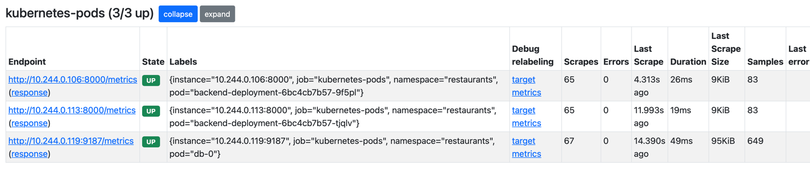
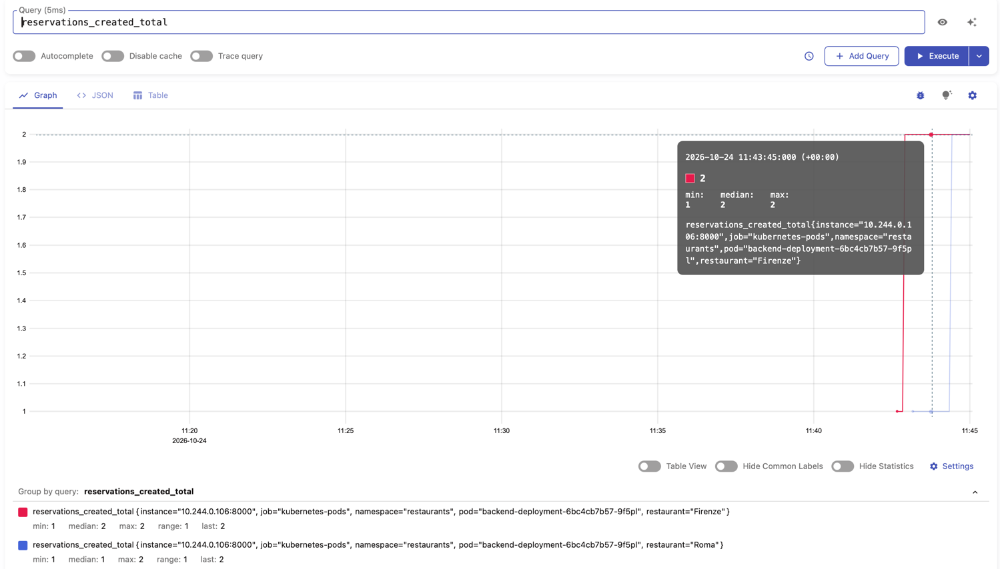
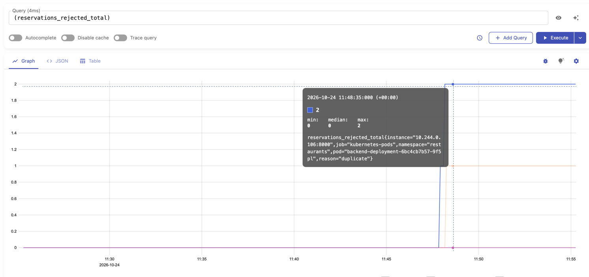
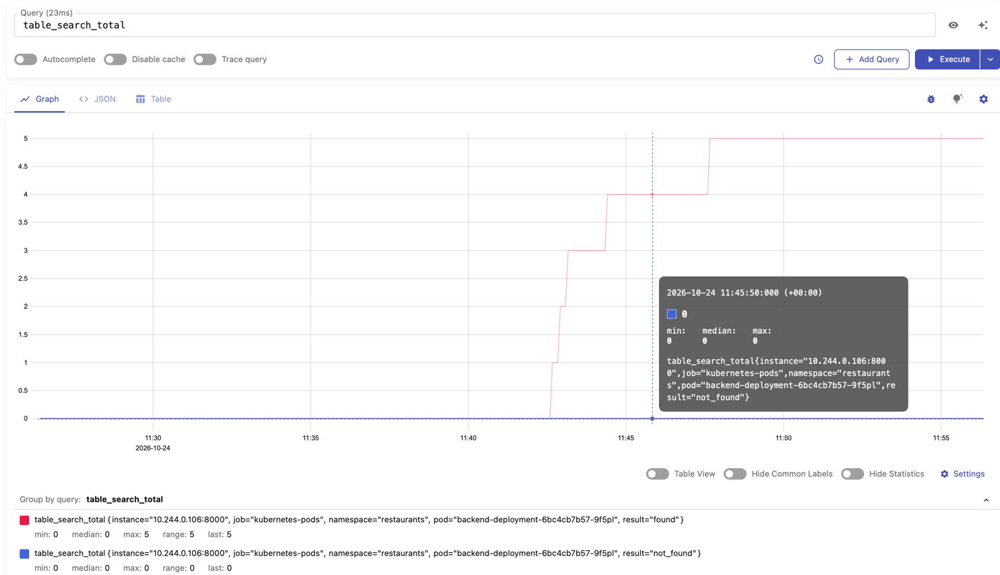
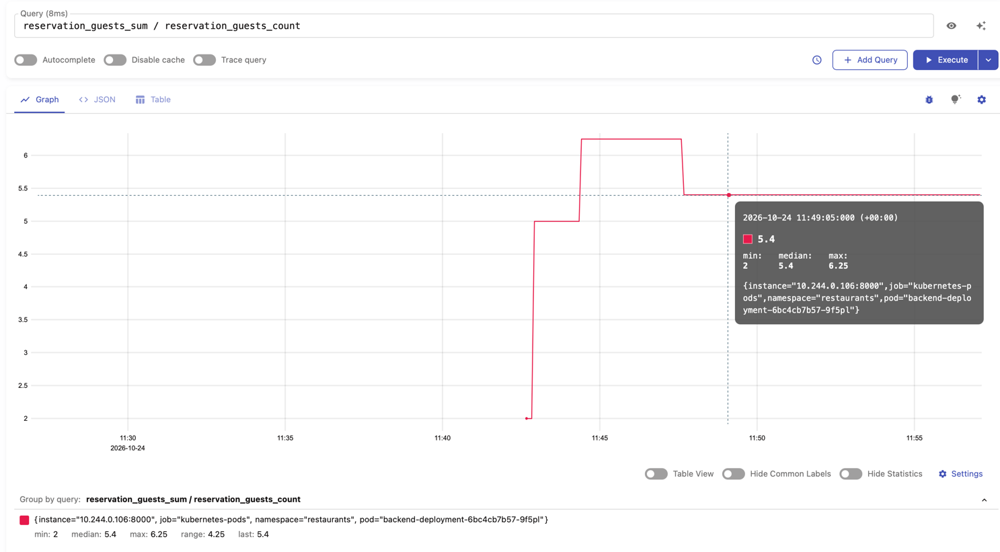
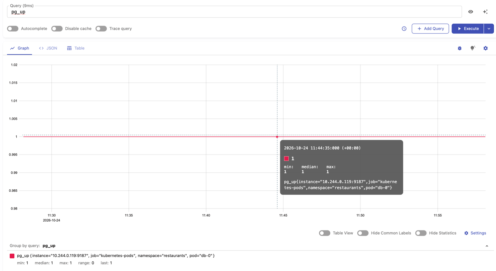
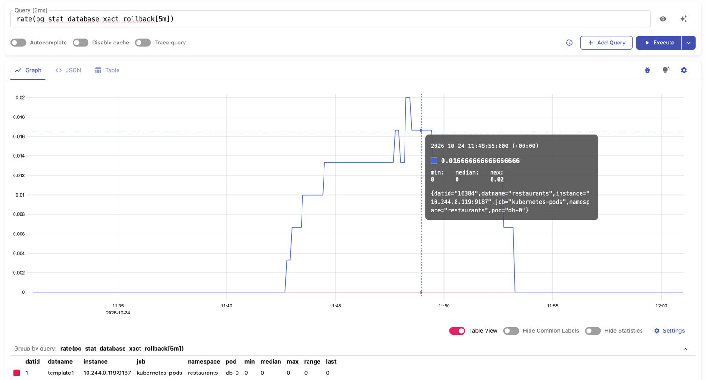

## Запуск
1. Запустить приложение в minikube
2. Пробросить порт VictoriaMetrics
```Bash
kubectl port-forward svc/vmsingle-victoria-metrics-single-server 8428:8428
```
3. Открыть `http://localhost:8428/vmui`
4. Active Targets `http://localhost:8428/targets`

## Работа с метриками

Для сбора метрик в minikube развёрнута VictoriaMetrics (хранилище метрик).
Установка выполнена через Helm-чарт `vm/victoria-metrics-single`, настройки
лежат в файле `guide-vmsingle-values.yml`. Сама VictoriaMetrics автоматически находит поды
по аннотациям `prometheus.io/scrape`, `prometheus.io/port` и `prometheus.io/path` и забирает с них метрики.

В backend на FastAPI метрики отдаются через библиотеку `prometheus-fastapi-instrumentator`,
в PostgreSQL через дополнительный контейнер `postgres-exporter` в поде базы.
Все собранные данные хранятся в VictoriaMetrics и отображаются в интерфейсе vmui.



Страница`http://localhost:8428/targets`
показывает, что VictoriaMetrics нашла поды backend
и PostgreSQL по аннотациям. Все цели в статусе UP.

## Реализованные бизнес-метрики

### 1. `reservations_created_total` (с меткой `restaurant`)

Считает успешно созданные брони по ресторанам. Показывает, какие рестораны бронируют чаще всего.



В vmui выполнен запрос `reservations_created_total`.

### 2. `reservations_rejected_total` (с меткой `reason`)

Считает отклонённые заявки по причинам: `validation` (нерабочее время или прошедшая дата),
`duplicate` (такая бронь уже есть), `create_failed` (ошибка при создании).
Помогает понять, почему гости не могут забронировать стол.



В vmui выполнен запрос `reservations_rejected_total`.

### 3. `table_search_total` (с меткой `result`)

Показывает, как часто при поиске стола находился свободный стол (`found`)
и как часто нет (`not_found`). Если `not_found` растёт, значит, в ресторанах
не хватает свободных мест.



В vmui выполнен запрос `table_search_total`.

### 4. `reservation_guests`

Показывает, на сколько гостей чаще всего бронируют столы.
Помогает понять, какие столы нужны ресторанам.



В vmui выполнен запрос `reservation_guests_sum / reservation_guests_count`,
он показывает среднее число гостей в брони.

## Метрики рантайма и PostgreSQL

- **Метрики рантайма FastAPI:** собираются через `prometheus-fastapi-instrumentator`
на эндпоинте `/metrics` (порт 8000). Включают HTTP-метрики (`http_requests_total`,
`http_request_duration_seconds`) и метрики процесса Python
(`process_resident_memory_bytes`, `process_cpu_seconds_total`).

- **Метрики PostgreSQL:** собираются через контейнер `postgres-exporter`
на порту 9187. Включают доступность базы (`pg_up`), размер базы (`pg_database_size_bytes`)
и число подключений (`pg_stat_database_numbackends`).



В vmui выполнен запрос `pg_up`, значение 1 означает, что exporter видит базу.



Запрос `rate(pg_stat_database_xact_rollback[5m])` показывает сколько транзакций в секунду откатывается.